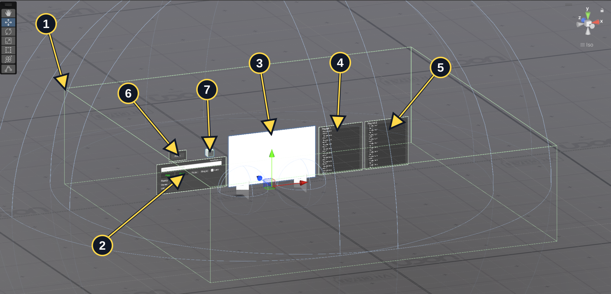

# HamaStream 簡易マニュアル

[README](../README.md) | [詳細マニュアル](USER_MANUAL.md)

## セットアップ

1. **HamaStream を使う準備をする** — VRChat Worlds SDK と UdonSharp を導入した Unity 2022.3.22f1 プロジェクトを用意します。
2. **HamaStream をプロジェクトに入れる** — 配布された `.unitypackage` を Unity の `Assets > Import Package > Custom Package...` から開き、全項目をインポートします。
3. **ワールドに動画プレイヤーを置く** — Unity の読み込みと UdonSharp のコンパイルが終わったら、`Tools > HamaStream > Add Minimal Player To Scene` を実行します。
4. **どこにいる人が動画を再生できるか決める** — 配置した `HamaStream` の BoxCollider で `Center` と `Size` を調整します。`Is Trigger` はオンにします。この範囲が `Playback Area` です。
5. **選んで再生できる動画を登録する** — プレイリストを使う場合は、`PlaylistControls1` と `PlaylistControls2` の Inspector で表示名と URL を入力します。
6. **リストの表示と複数プレイヤーの読み込みを整える** — `Tools > HamaStream > Configure Scene Playlists` と `Tools > HamaStream > Configure Scene URL Load Peers` を実行し、シーンを保存します。プレイリストを増減したら前者、プレイヤーを追加・複製・削除したら両方を再実行します。
7. **ワールド内で動作を確かめる** — VRChat の Build & Test で再生や操作を確認します。

Prefab を作り直したいときは `Tools > HamaStream > Rebuild Minimal Prefab` を使います。詳しい設定は [詳細マニュアル](USER_MANUAL.md#セットアップの詳細) を参照してください。

## 画面構成

画像の番号が、各モジュールと UI の位置を示します。

| 番号 | モジュール・UI | 役割 |
| --- | --- | --- |
| 1 | 再生範囲（`Playback Area`） | この範囲にいる人だけが動画を再生します。緑の枠は Unity の Scene ビューでの表示です。 |
| 2 | 操作パネル（`Controls`） | URL 入力、再生・一時停止・停止、ループ設定、状態表示をまとめたパネルです。 |
| 3 | スクリーン（`Screen`） | 映像と、再生していないときの待機画面を表示します。 |
| 4 | プレイリスト 1（`PlaylistControls1`） | 登録した動画を選ぶパネルです。 |
| 5 | プレイリスト 2（`PlaylistControls2`） | もう一つの動画リストです。プレイリストは Unity で増減できます。 |
| 6 | 再同期ボタン | 自分の映像だけを読み込み直す独立したボタンです。 |
| 7 | 再同期キューブ | キューブに Interact すると、6 と同じ再同期を行います。 |

## 操作方法

| 操作 | 機能 | 動作 |
| --- | --- | --- |
| URL 欄に入力して `Play` | 好きな URL の動画を再生する | URL と再生状態を全員に共有し、入力欄を空にします。 |
| プレイリストの項目を選択 | 登録済みの動画を再生する | 選んだ URL を全員に共有して再生します。 |
| `Pause` | 自分だけ視聴を一時停止する | 自分の再生位置を保って停止します。ほかの人の再生は続きます。 |
| URL 欄を空にして `Play` | 現在の動画を再開する | 自分の一時停止を解除します。共有再生が停止中なら、現在の URL で再生を始めます。 |
| `Stop` | 全員の再生を止める | 共有再生を停止します。URL は残ります。 |
| `Resync` | ライブ配信などの映像を自分だけ読み込み直す | 現在の URL に自分だけ再接続します。独立した再同期ボタンやキューブでも操作できます。 |
| `Loop` | 繰り返し再生を切り替える | ループ設定を全員に共有します。 |

再生範囲を出ると自分の再生が一時停止し、戻ると再開します。URL の読み込みや再同期を続けて行う場合は、約 5 秒待ってください。
