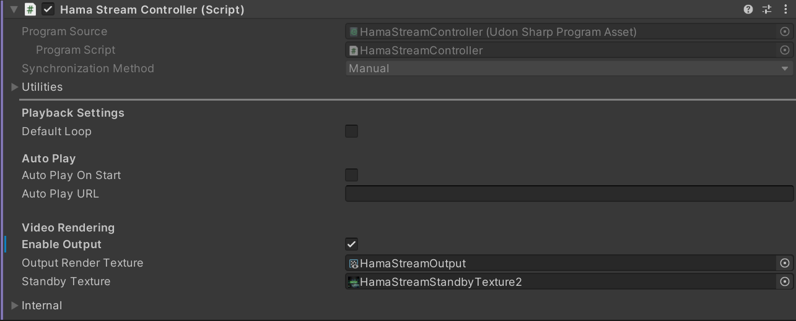
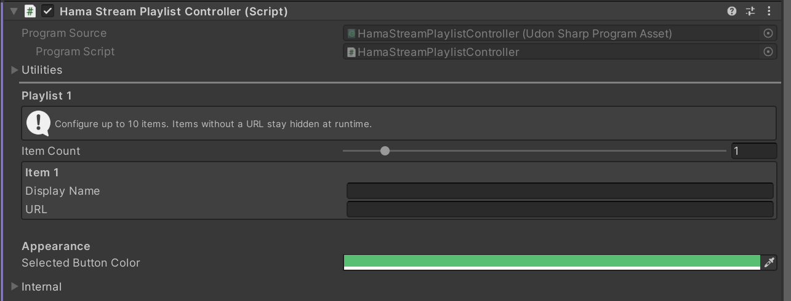

# HamaStream 詳細マニュアル

[README](../README.md) | [クイックスタート](QUICK_START.md)

## 対象環境

VRChat PC 版のワールドで動作します。開発環境は Unity 2022.3.22f1、VRChat Worlds SDK、UdonSharp です。Quest 版は対象外です。動画再生には SDK の AVPro Video を使用します。

映像補正と画面表示には ArchiTech.ProTV 由来の改変シェーダーを使用します。HamaStream に同梱されるため ProTV パッケージを別途導入する必要はありません。シェーダーの出自とライセンスは [第三者ライセンス](../THIRD_PARTY_NOTICES.md) に記載しています。

## セットアップの詳細

1. VRChat Worlds SDK と UdonSharp を導入した Unity 2022.3.22f1 プロジェクトを用意します。配布された `.unitypackage` を `Assets > Import Package > Custom Package...` から開き、全項目をインポートします。
2. Unity のインポートと UdonSharp のコンパイル完了を待ち、Console のエラーを確認します。
3. `Tools > HamaStream > Add Minimal Player To Scene` を実行し、プレイヤーをシーンに配置します。
4. `Playback Area` の BoxCollider を視聴範囲に合わせ、`Is Trigger` をオンにします。
5. プレイリストを使う場合は、`PlaylistControls` ごとに付く `HamaStreamPlaylistController` を設定します。初期状態では 2 つあります。
6. `Tools > HamaStream > Configure Scene` を実行し、シーンを保存します。プレイリストの増減や、プレイヤーの追加・複製・削除後にも再実行します。この操作で各プレイリストの参照と番号、シーン内プレイヤー間の URL 読み込み参照が更新されます。
7. VRChat の Build & Test で URL 再生、範囲内外の動作、複数人での共有を確認します。AVPro Video の確認には VRChat クライアントを使用します。

更新時は、新しい版の `.unitypackage` を同じ Unity プロジェクトへ全項目インポートします。

## HamaStreamController の Inspector

プレイヤー本体の `HamaStreamController` を選択します。

| 項目 | 説明 |
| --- | --- |
| `Default Loop` | ループ設定の初期状態。 |
| `Auto Play On Start` | オンの場合、インスタンス開始時に設定 URL の共有再生を開始します。 |
| `Auto Play URL` | 自動再生する URL。空欄なら自動再生しません。 |
| `Enable Output` | 映像を Render Texture に出力する場合にオン。 |
| `Output Render Texture` | 映像の出力先。`Enable Output` がオンの場合に表示。未指定だと出力されません。 |
| `Standby Texture` | 停止・読み込み待ち・再生終了・動画エラー時にスクリーンへ表示する画像。`Enable Output` がオンなら Render Texture にも出力します。未指定なら従来の表示のままです。 |

自動再生を使う場合は `Auto Play URL` を設定して `Auto Play On Start` をオンにします。最初の再生はオーナーが共有状態へ反映します。ワールド内 UI の URL 再生やプレイリスト選択が受理されると、その URL に切り替わり、初期 URL は再開しません。`Stop` 後も自動再生は繰り返されません。

URL 読み込み直後の手動切り替えには、最低 5 秒の間隔制限があります。再生範囲外では URL を共有してもローカル再生は始まりません。

スタンバイ画像を設定するには、画像を `Standby Texture` に割り当てます。一時停止中は映像フレームを維持します。

視聴できる範囲を変えるには、`HamaStream` の BoxCollider の `Center` と `Size` を調整します。`Is Trigger` はオンにします。

## HamaStreamPlaylistController の Inspector

初期状態では Playlist 1 と Playlist 2 があり、それぞれ最大 10 件登録できます。項目の URL が空ならワールド内では表示されません。各 `PlaylistControls` の同じ GameObject に UI と Controller があります。

| 項目 | 説明 |
| --- | --- |
| `Item Count` | 登録する項目数。0～10。 |
| `Display Name` | 項目の表示名。空欄なら表示名も空欄です。 |
| `URL` | 選択時に再生する URL。 |
| `Selected Button Color` | 選択中のボタン色。 |

プレイリストの項目を選ぶと、登録 URL の共有再生が始まります。自動連続再生や前後への移動はありません。直接 URL を再生すると、プレイリストの選択表示は解除されます。

プレイリストを追加するには、シーン内の HamaStream を選択し、`Tools > HamaStream > Add Playlist To Selected Player` を実行します。削除するには対象の `PlaylistControls` を選択し、`Tools > HamaStream > Remove Selected Playlist` を実行します。どちらも参照と見出しを自動更新します。

手動で GameObject を削除した場合は `Tools > HamaStream > Configure Scene` を実行してください。配置順で番号が振り直されます。

## VRChat 内での操作と共有範囲

| 操作 | 影響 |
| --- | --- |
| URL を入力して確定（Enter または入力欄から移動） | URL と再生状態を全員に共有して再生。`Play` を押す必要はありません。 |
| URL 入力欄が空のまま `Play` | 現在の共有 URL で再生またはローカル一時停止を解除。 |
| プレイリスト選択 | URL、再生状態、選択項目を共有。 |
| `Pause` | 自分だけ一時停止。再生位置を保持します。 |
| `Stop` | 全員の再生を停止。共有 URL は保持します。 |
| `Resync` または再同期キューブ | 自分だけ現在の URL に再接続。共有状態は変更しません。 |
| `Loop` | ループ設定を全員に共有。 |

再生範囲外ではそのユーザーの再生が一時停止し、範囲内に戻ると再開します。再生位置は HamaStream 側で同期しません。通常動画への途中参加では先頭から再生されます。URL の読み込みや Resync を続けて操作した場合は、約 5 秒待つ必要があります。

## ステータス表示

操作パネルのステータス欄には、現在の再生状態や操作できない理由が英語で表示されます。

| 表示 | 意味・対処 |
| --- | --- |
| `Stopped` | 再生が停止しています。URL を入力するか、プレイリストから動画を選んでください。 |
| `Waiting for URL` | 再生する URL を待っています。URL を入力するか、プレイリストから動画を選んでください。 |
| `Waiting to load URL` | 次の動画を読み込めるまで待機しています。しばらくすると自動で読み込みます。 |
| `Loading` / `Resyncing` | 動画を読み込み中、または再同期中です。 |
| `Waiting for video` / `Ready to play` | 動画の再生準備中です。少し待ってください。 |
| `Playing` | 動画を再生しています。 |
| `Paused (local)` | 自分が `Pause` で一時停止しています。再開するには `Play` を押してください。 |
| `Paused (outside range)` | 再生範囲の外にいます。範囲内に戻ると再開します。 |
| `Paused` | 動画が一時停止しています。 |
| `Looping` | ループ再生で動画の終端に達しました。 |
| `Ended` | 動画の再生が終了しました。 |
| `Enter a URL` | 再生する URL がありません。URL を入力するか、プレイリストから動画を選んでください。 |
| `Please wait before loading another URL` | 次の動画への切り替えが早すぎます。約 5 秒待ってから再操作してください。 |
| `Please wait before resyncing` | 再同期の間隔が短すぎます。約 5 秒待ってから再操作してください。 |
| `Playlist is not registered` | 選んだプレイリストを利用できません。Unity で `Tools > HamaStream > Configure Scene` を実行してください。 |
| `Playlist URL is empty` | 選んだ項目に URL がありません。Unity でその項目の `URL` を設定してください。 |
| `Configuration error` | プレイヤーの設定が不足しています。Unity で Prefab とシーンの設定を確認してください。 |
| `Video error: ...` | 動画の読み込みまたは再生でエラーが発生しました。URL と VRChat PC クライアントでの再生可否を確認してください。 |
| `Local player unavailable` / `Could not take ownership` | VRChat 内で操作を共有できませんでした。少し待って再操作し、続く場合はワールドに入り直してください。 |
