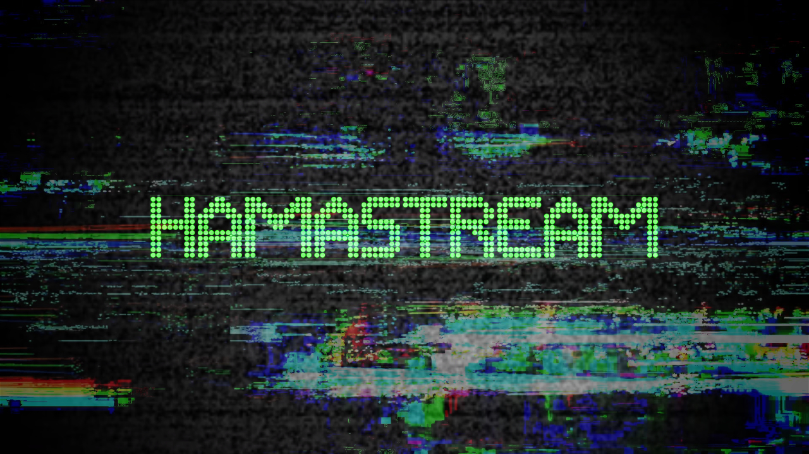

# HamaStream

HamaStream は VRChat の 音楽イベント向けの動画・配信プレイヤーです。ワールド内の複数配置に対応するため制作されました。各プレイヤーにはコライダーで再生範囲が設定され、ユーザーが範囲内にいるプレーヤーのみ再生することでワールド負荷の低減を実現しています。

## ダウンロード

[HamaStream.unitypackage](Releases/HamaStream.unitypackage) をダウンロードし、Unity の `Assets > Import Package > Custom Package...` からインポートしてください。VRChat Worlds SDK と UdonSharp は事前に導入してください。

## 動作環境

- VRChat Worlds SDK と UdonSharp を導入済みの Unity プロジェクト
- Unity 2022.3.22f1（開発・確認環境）
- VRChat PC クライアント（Quest 版は対象外）

## 導入方法

初めて使う場合は [クイックスタート](Docs/QUICK_START.md) に沿って導入してください。Inspector の各項目の設定は [詳細マニュアル](Docs/USER_MANUAL.md) を参照ください。

## 主な機能

- URL 入力からの再生、共有停止、ループ切り替え
- 増減できるプレイリストモジュール（初期 2 つ、各最大 10 項目）
- ユーザーごとの一時停止と Resync
- 再生範囲外でのローカル一時停止と、範囲内へ戻ったときの再開

動画再生時の再生位置は同期されません。通常動画の途中参加者は先頭から再生されます。詳しい操作と制約は [詳細マニュアル](Docs/USER_MANUAL.md) を参照してください。

## 更新

更新時は同じ Unity プロジェクトへ新しい版の `.unitypackage` をインポートしてください。

## ProTV 由来のシェーダー

映像補正用の `HamaStreamVideoBlit.shader` は ArchiTech.ProTV 3.0.0-beta.31 の `ProTVBlit.shader` を改変したものです。画面表示用の `HamaStreamVideoScreen.shader` も、同じ ProTV の `ProTVVideoScreen.shader` を改変したものです。両シェーダーを HamaStream に同梱しているため、ArchiTech.ProTV パッケージの別途導入は不要です。出自、変更内容、再配布条件は [第三者ライセンス](THIRD_PARTY_NOTICES.md) を確認してください。

## ライセンス

HamaStream の独自ファイルは [MIT License](LICENSE) です。同梱する映像補正・画面表示 Shader は ArchiTech.ProTV 由来で、[第三者ライセンス](THIRD_PARTY_NOTICES.md) が適用されます。VRChat SDK や UdonSharp は同梱しません。
